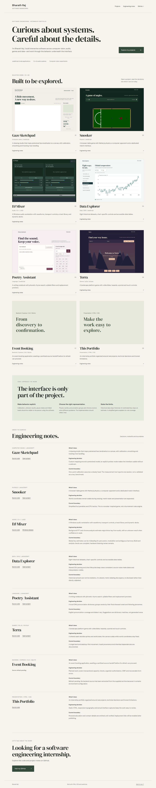

# Bharath Raj — Portfolio

Recruiters need a clear route from a project interface to the engineering decisions behind it. This static portfolio presents real work and states its current boundaries.



## Demo

Local preview works with the setup below. GitHub Pages publication is pending destination authentication; a live URL will be added after verification.

## What it does

- Immediate name, software engineering focus and project navigation.
- Eight project entries and individual technical case notes.
- Actual interface captures from the local finished applications.
- Responsive warm-neutral typography, visible focus, skip link and reduced-motion support.
- Verified project copy and GitHub link, without fictional testimonials, proficiency percentages or simulated contact success.

## Run locally

```sh
python -m http.server 8000 --bind 127.0.0.1
```

Open http://127.0.0.1:8000/ in a modern browser. Run the command inside this repository. Do not open `index.html` directly from disk: local datasets/model assets use HTTP. Python 3 is only a local static server; no application build is required.

## Controls

Choose a project to read its engineering notes, or follow the source/demo links. On localhost, browser demo links open the sibling projects in this workspace. Public demo URLs are provisional until repositories are deployed and verified.

## Architecture and decisions

`index.html` contains content and case studies. `portfolio.css` defines the responsive visual system. `portfolio.js` changes demo URLs only in localhost previews. Project screenshots under `images/` are actual application captures; no generated screenshots are used.

## Limitations

Event Booking’s refresh is pending a sanitized archive and is labeled accordingly. Education, email, LinkedIn and CV are intentionally absent until verified. Repository/demo links cannot be called working until publication is completed.

## Validation

Edge confirms eight entries and a phone layout without document overflow. Source screenshots were captured from the applications, including a JUCE component capture of the built Windows executable.

## Third-party attribution

DM Sans and DM Serif Display via Google Fonts. Screenshot credit belongs to the corresponding applications and their documented dependencies.

